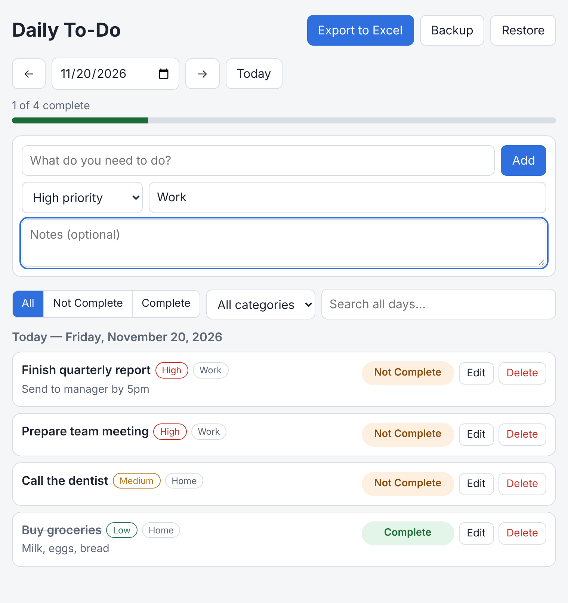
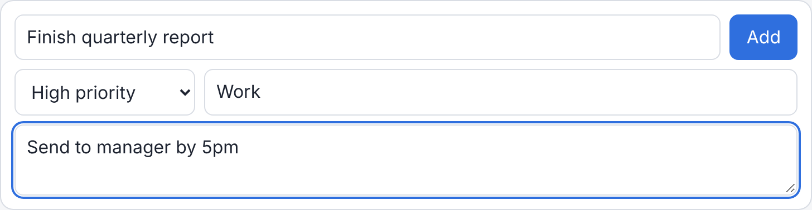
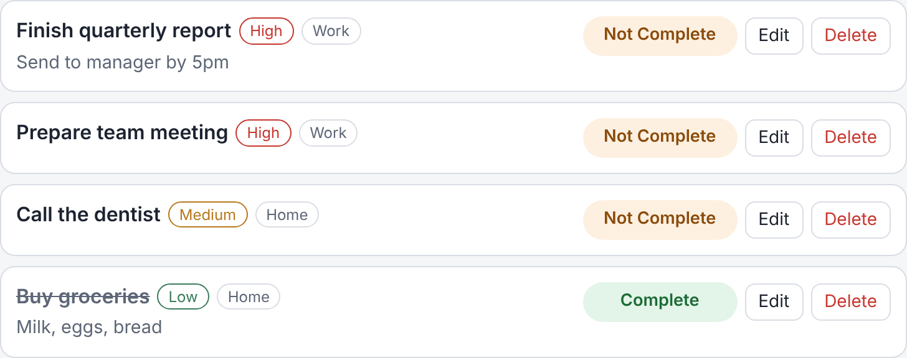
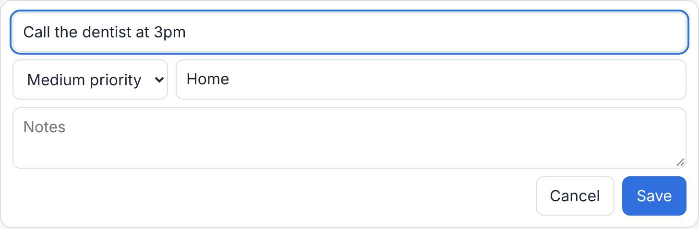
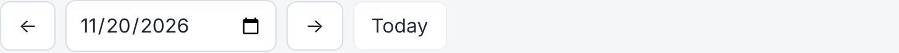
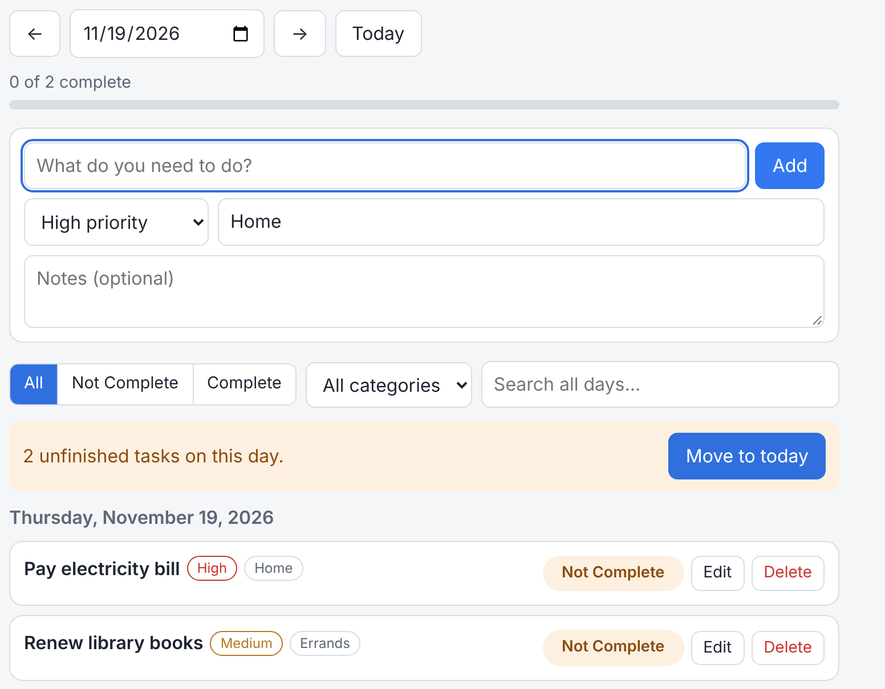
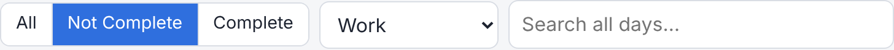
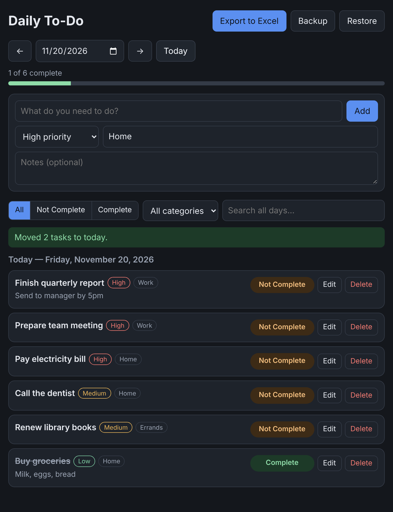

# Daily To-Do: User Guide

A simple web page for keeping track of the tasks you need to do each day.

**Contents**
1. [Opening the app](#1-opening-the-app)
2. [Adding a task](#2-adding-a-task)
3. [Marking tasks Complete / Not Complete](#3-marking-tasks-complete--not-complete)
4. [Editing and deleting tasks](#4-editing-and-deleting-tasks)
5. [Moving between days](#5-moving-between-days)
6. [Moving unfinished tasks to today](#6-moving-unfinished-tasks-to-today)
7. [Filtering and searching](#7-filtering-and-searching)
8. [Exporting to Excel](#8-exporting-to-excel)
9. [Backing up and restoring your tasks](#9-backing-up-and-restoring-your-tasks)
10. [Dark mode](#10-dark-mode)
11. [Where your tasks are saved](#11-where-your-tasks-are-saved)
12. [Troubleshooting](#12-troubleshooting)

There's also a [78-second demo video](demo.mp4).

---

## 1. Opening the app

You don't need to install anything.

1. Download the project from GitHub: open the repository, click the green **Code** button, then **Download ZIP**.
2. Unzip the file (Windows: right-click → **Extract All**; Mac: double-click it).
3. Open the unzipped folder and double-click **`index.html`**. It opens in your web browser.

**Tip:** Bookmark the page so you can come back to it quickly. Always use the same browser (see [section 11](#11-where-your-tasks-are-saved)).

If `index.html` opens in a text editor instead, right-click it → **Open with** → choose Chrome, Edge, Firefox or Safari.

---

## 2. Adding a task

1. Type what you need to do in **"What do you need to do?"**.
2. *(Optional)* Choose a **priority**: High, Medium (default) or Low.
3. *(Optional)* Type a **category**, such as *Work*, *Home* or *Errands*. Categories you've used before are suggested as you type.
4. *(Optional)* Add **notes**: extra details shown in smaller text under the task.
5. Click **Add** or press **Enter**.

The task is added to the day currently shown at the top (today, by default).

The priority and category you picked stay selected for the next task, which makes adding several similar tasks quicker.

**How tasks are ordered:** unfinished tasks come first, then by priority (High → Medium → Low), then oldest first.

---

## 3. Marking tasks Complete / Not Complete

Each task has a status button on the right:

| Button | Meaning |
|---|---|
| **Not Complete** (orange) | Still to do |
| **Complete** (green) | Done; the title is crossed out |

**Click the button to switch** between Complete and Not Complete. Click again to switch back.

The **progress bar** at the top shows how many of the day's tasks are done (for example, "1 of 4 complete").

---

## 4. Editing and deleting tasks

**To edit:**
1. Click **Edit** on the task.
2. Change the title, priority, category or notes.
3. Click **Save**, or **Cancel** (or press **Esc**) to discard changes.

**To delete:** click **Delete**, then **OK** in the confirmation box. Deleting can't be undone (unless you have a [backup](#9-backing-up-and-restoring-your-tasks)).

---

## 5. Moving between days

- **←** / **→** go to the previous / next day.
- Click the **date** to pick any day from a calendar.
- **Today** jumps back to today.

Tasks you add are saved to the day shown. You can plan ahead by going to a future day and adding tasks there.

---

## 6. Moving unfinished tasks to today

When you look at a **past day** that still has unfinished tasks, an orange bar appears:

Click **Move to today** to move all of that day's **Not Complete** tasks to today. Completed tasks stay where they were, so your history is kept.

---

## 7. Filtering and searching

- **All / Not Complete / Complete:** show only tasks with that status.
- **Category list:** show only one category (e.g. *Work*).
- **Search all days:** type any word to find tasks on **any day**. It searches titles, notes and categories. Results show each task's date. Clear the box to go back to the normal day view.

Filters can be combined, e.g. *Not Complete* + *Work*.

---

## 8. Exporting to Excel

Click **Export to Excel**. A file named like `todo-export-2026-11-20.xlsx` downloads to your Downloads folder.

It contains **every task from every day** (not just the day shown), with these columns:

| Title | Notes | Date | Priority | Category | Status | Created |
|---|---|---|---|---|---|---|

Rows are sorted by date. Open the file in Excel, Google Sheets, Numbers or LibreOffice.

**Note:** Export needs an internet connection the first time the page loads (it uses a free library called SheetJS). Everything else works offline.

---

## 9. Backing up and restoring your tasks

**Backup** downloads a file named like `todo-backup-2026-11-20.json` containing all your tasks. Keep it somewhere safe (e.g. cloud storage).

**Restore** loads a backup file:
1. Click **Restore** and choose a backup `.json` file.
2. Confirm that you want to **replace** your current tasks with the ones in the file.

If the file isn't a valid backup, nothing is changed and you'll see a message saying why.

Use Backup / Restore to:
- protect against losing tasks if browser data is cleared;
- move your tasks to another computer or browser.

> The Excel file is for viewing and sharing. To restore tasks, use the backup `.json` file, not the Excel file.

---

## 10. Dark mode

The app switches to dark colors automatically when your computer or phone is set to dark mode. There's no separate switch in the app.

---

## 11. Where your tasks are saved

Tasks are saved **in your browser** on your computer, automatically, every time you make a change. Nothing is sent to the internet.

This means:
- Use the **same browser** each time. Chrome and Edge, for example, don't share tasks.
- Other computers and phones won't see your tasks (use [Backup / Restore](#9-backing-up-and-restoring-your-tasks) to move them).
- **Clearing your browser's history/site data, or using a private/incognito window, can delete them.** Make a backup regularly.

---

## 12. Troubleshooting

| Problem | What to do |
|---|---|
| "Excel export needs an internet connection…" | Connect to the internet and reload the page, then try again. |
| My tasks disappeared | Check you're in the same browser and not in a private window. If browser data was cleared, use **Restore** with your latest backup. |
| `index.html` opens as text | Right-click → **Open with** → a web browser. |
| "Restore failed…" | The chosen file isn't a to-do backup. Pick a `todo-backup-….json` file. Your tasks weren't changed. |
| Task won't add | The title can't be empty. |
| I can't find a task | Clear the search box and set filters to **All** / **All categories**, or check you're on the right day. Use search to look across all days. |
